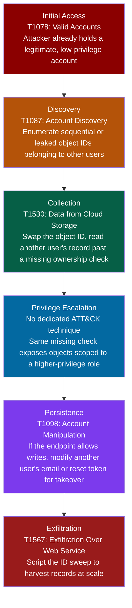

# Broken Access Control (IDOR / BOLA) → ATT&CK Chain

## What the Scanner Flags

- **CWE-639**: Authorization Bypass Through User-Controlled Key
- **CWE-284**: Improper Access Control (parent category)
- **OWASP**: API1:2023 Broken Object Level Authorization (OWASP API Security Top 10); also OWASP Top 10 2021 A01 Broken Access Control
- **Common findings**: `[Authorize]` present but no per-resource ownership check, Entity Framework `.Find(id)` or `.FirstOrDefault(x => x.Id == id)` with no accompanying `UserId`/tenant filter, a client-supplied ID trusted directly in a route or request body

## ATT&CK Techniques Enabled

| Tactic | Technique ID | Technique Name | How |
|--------|-------------|----------------|-----|
| Initial Access | [T1078](https://attack.mitre.org/techniques/T1078/) | Valid Accounts | No exploit or credential theft needed, the attacker is already an authenticated user, often on a free tier or trial account |
| Discovery | [T1087](https://attack.mitre.org/techniques/T1087/) | Account Discovery | Attacker enumerates predictable identifiers (sequential integers, low-entropy UUIDs, or IDs leaked in other API responses) to find objects owned by other users |
| Collection | [T1530](https://attack.mitre.org/techniques/T1530/) | Data from Cloud Storage | Swapping the object ID in an otherwise legitimate authenticated request returns another user's data, because the server validated authentication but never checked ownership of that specific object |
| Privilege Escalation | *(none cleanly maps)* | Authorization logic flaw | The same missing check can expose objects scoped to an admin or higher-tier role; ATT&CK has no dedicated technique for this because it models infrastructure and host behavior, not application authorization logic |
| Persistence | [T1098](https://attack.mitre.org/techniques/T1098/) | Account Manipulation | If the vulnerable endpoint accepts writes, the attacker changes another user's email or password reset token using the same ID-swap technique, and takes over the account |
| Exfiltration | [T1567](https://attack.mitre.org/techniques/T1567/) | Exfiltration Over Web Service | The enumeration is scripted to sweep the full ID range and harvest every reachable record |

**Note on the ATT&CK gap**: unlike the other mappings in this repo, Broken Access Control doesn't have a clean 1:1 technique at every stage. ATT&CK was built to describe adversary behavior against infrastructure and endpoints, and it covers web app logic flaws like IDOR unevenly. That gap is itself a useful thing to know going into a threat modeling conversation: ATT&CK is a good shared vocabulary, not a complete map of the OWASP API Top 10.

## IDOR vs. BOLA vs. BFLA

**IDOR (Insecure Direct Object Reference)** is the general term: any place a client-supplied reference (ID, filename, key) is trusted without an ownership check.

**BOLA (Broken Object Level Authorization)** is OWASP's API-specific framing of the same bug, now API1:2023 in the OWASP API Security Top 10, reflecting how common it is in REST and GraphQL APIs specifically.

**BFLA (Broken Function Level Authorization)** is the sibling bug: instead of swapping an object ID, the attacker calls an endpoint their role shouldn't have access to at all (a regular user hitting an admin-only route). Same root cause, missing authorization check, different axis (which object vs. which function).

## .NET Specific Attack Surface

**`[Authorize]` is not an ownership check.** `[Authorize(Roles = "User")]` on `GET /api/invoices/{id}` confirms the caller is authenticated and has the User role. It says nothing about whether this specific invoice belongs to this specific caller. Any authenticated user can request any invoice ID unless the handler explicitly checks it.

**Entity Framework makes the gap easy to miss.** `_context.Invoices.Find(id)` or `_context.Invoices.FirstOrDefault(i => i.Id == id)` "just works" against a developer's own test data, because in dev there's usually only one user's data to test against. The missing `.Where(i => i.UserId == currentUserId)` clause doesn't surface as a bug until a second account exists.

**Minimal APIs remove the scaffolding that used to nudge this.** Classic MVC controllers with base classes sometimes centralized auth checks. `app.MapGet("/invoices/{id}", async (int id, AppDbContext db) => ...)` has no such structure by default, every route handler is responsible for its own ownership check from scratch.

**GraphQL compounds it.** A single query can request nested objects across multiple types in one call; an ownership check on the top-level field doesn't automatically apply to a nested resolver three levels deep.

## Detection Strategies by Stage

### At Discovery (T1087)
- Alert on a single account requesting a sequential or rapidly incrementing range of object IDs
- Log object-level access as `(requesting_user_id, requested_object_id, owner_user_id)`, most logging stacks don't capture the owner field by default, which is exactly the field needed to detect this

### At Collection (T1530)
- The highest-signal detection for IDOR: alert whenever `requesting_user_id != owner_user_id` on a request that returned 200 OK
- Baseline typical unique-object-count per session per user; a jump from "views 5 invoices a day" to "requests 400 invoice IDs in an hour" is the tell

### At Persistence (T1098)
- Require re-authentication or step-up verification (OTP, email confirmation) for account-modifying actions, not just a valid session
- Alert when an account modification's authenticated session user ID doesn't match the account record being modified

### At Exfiltration (T1567)
- Rate-limit per-account API calls; a human doesn't request tens of thousands of sequential object IDs in a short window
- Alert on access patterns matching enumeration: monotonic ID sequence, high unique-object count, low per-object dwell time

## Response Playbook

### Contain
1. Revoke or rotate the attacking account's active sessions; force a password reset if it's a real registered account
2. Rate-limit or temporarily suspend the account pending investigation
3. If the IDOR allowed writes, lock the affected records until integrity can be verified

### Investigate
1. Pull object-access logs for the attacking account to determine the actual range and count of other users' records read
2. Check for any writes or modifications made to other users' data during the window of access
3. Determine whether the vulnerable endpoint has been exposed since its original release or was introduced by a recent change, this sizes the real exposure window

### Remediate
1. Add an explicit ownership check to every handler that accepts a client-supplied object ID: scope the query to the authenticated user, not just their role
2. Replace sequential integer IDs with non-guessable identifiers (UUIDv4) as defense in depth; this doesn't fix the authorization bug but raises the cost of blind enumeration
3. Add integration tests asserting that User A's valid session cannot read or write User B's resources

### Prevent Recurrence
1. Code review checklist item: any endpoint accepting an ID in the route or body must show its ownership check in the same diff
2. SAST rule for Entity Framework patterns like `.Find(id)` or `.FirstOrDefault(x => x.Id == id)` with no accompanying `UserId` or tenant filter in the same method
3. Centralize ownership checks in a single authorization layer or middleware rather than relying on every handler to remember

## Cross-References

- [Insecure Deserialization Mapping](insecure-deserialization.md) for a comparison of execution-based vs. logic-based vulnerability chains
- OWASP API Security Top 10, API1:2023 Broken Object Level Authorization: https://owasp.org/API-Security/editions/2023/en/0xa1-broken-object-level-authorization/
- CWE-639: https://cwe.mitre.org/data/definitions/639.html
