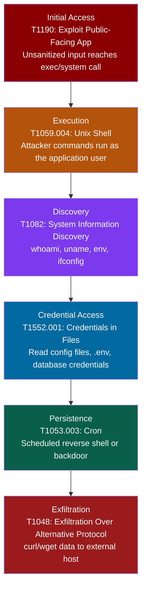

# Command Injection (OS Command Injection)

## Attack Lifecycle

## ATT&CK Techniques

| Stage | Technique ID | Technique Name | How It Applies |
|-------|-------------|----------------|----------------|
| Initial Access | T1190 | Exploit Public-Facing Application | User input is passed to a system command without sanitization (e.g., `exec()`, `system()`, `child_process.exec()`) |
| Execution | T1059.004 | Unix Shell | Injected commands execute in a shell context with the privileges of the application process |
| Discovery | T1082 | System Information Discovery | Attacker runs reconnaissance commands to understand the host, network, and environment variables |
| Credential Access | T1552.001 | Credentials in Files | Reads application config files, environment variables, database connection strings, API keys from disk |
| Persistence | T1053.003 | Cron | Writes a cron job or systemd timer to maintain access via a reverse shell or periodic callback |
| Exfiltration | T1048 | Exfiltration Over Alternative Protocol | Uses curl, wget, or DNS exfiltration to send stolen data to an attacker-controlled server |

## Detection Strategies by Stage

### Initial Access: Command Injection Attempt

- DAST scanning with command injection payloads against all user-input endpoints
- SAST rules to detect user input flowing into shell execution functions without sanitization
- WAF rules to detect shell metacharacters (`;`, `|`, `&&`, `$()`, backticks) in request parameters
- Log all HTTP requests that trigger application errors with shell-related stack traces

### Execution: Shell Activity

- Monitor process creation on application servers for unexpected child processes spawned by the application user (e.g., `sh`, `bash`, `curl`, `wget` spawned by `node` or `python`)
- Auditd rules to log all `execve` syscalls from the application user
- EDR alerting on shell spawning from web server processes

### Discovery: Reconnaissance

- Alert on execution of reconnaissance commands (`whoami`, `id`, `uname`, `ifconfig`, `env`, `cat /etc/passwd`) from application processes
- File access monitoring for sensitive paths (`/etc/shadow`, `/proc/self/environ`, application config directories)

### Credential Access: Config File Reads

- File integrity monitoring on `.env`, config files, and credential stores
- Alert on reads to database config files from processes other than the application during startup
- Monitor for environment variable dumps from application child processes

### Persistence: Backdoor Installation

- Monitor cron directories for new entries (`/var/spool/cron`, `/etc/cron.d`)
- Alert on new systemd service or timer creation
- Monitor for outbound connections to unfamiliar hosts from application servers

## Response Playbook

1. **Identify the injection point.** Determine which endpoint and parameter accepted the injected command. Check application logs for unusual request patterns with shell metacharacters.
2. **Determine scope of execution.** Review process logs and auditd output to identify every command the attacker ran. Check command history if available.
3. **Assess credential exposure.** Identify which config files, environment variables, and secrets the attacker could have read. Rotate all credentials accessible from that host.
4. **Check for persistence.** Audit cron jobs, systemd timers, authorized_keys, and any new files created during the compromise window. Remove any backdoors.
5. **Patch the vulnerability.** Replace `exec()`/`system()` with safe alternatives that do not invoke a shell. Use parameterized subprocess calls (e.g., `execFile()` in Node.js, `subprocess.run()` with a list argument in Python). Validate and sanitize all input that must reach system commands.
6. **Harden the host.** Apply least-privilege to the application user. Restrict outbound network access. Enable mandatory access controls (AppArmor, SELinux) to limit what the application process can execute.

## Cross-References

- Related to [SQL Injection](sql-injection.md) in that both are injection flaws where user input reaches a dangerous interpreter
- Command injection via file upload (uploading a file with a crafted filename that is later passed to a shell command) is a common variant
- OWASP Top 10 2021: A03 Injection
