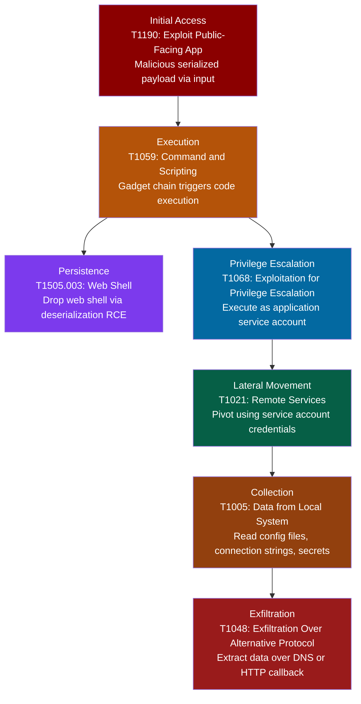

# Insecure Deserialization → ATT&CK Chain

## What the Scanner Flags

- **CWE-502**: Deserialization of Untrusted Data
- **OWASP**: A08:2021 Software and Data Integrity Failures
- **Common findings**: `BinaryFormatter.Deserialize()`, `TypeNameHandling.All` in JSON.NET, `XmlSerializer` with attacker-controlled type, `ObjectInputStream.readObject()` in Java

## ATT&CK Techniques Enabled

| Tactic | Technique ID | Technique Name | How |
|--------|-------------|----------------|-----|
| Initial Access | [T1190](https://attack.mitre.org/techniques/T1190/) | Exploit Public-Facing Application | Attacker sends a crafted serialized object through an API endpoint, form field, cookie, or message queue |
| Execution | [T1059](https://attack.mitre.org/techniques/T1059/) | Command and Scripting Interpreter | Gadget chain within the application's loaded assemblies executes arbitrary commands during deserialization |
| Persistence | [T1505.003](https://attack.mitre.org/techniques/T1505/003/) | Server Software Component: Web Shell | RCE used to write a web shell to a publicly accessible directory on the server |
| Privilege Escalation | [T1068](https://attack.mitre.org/techniques/T1068/) | Exploitation for Privilege Escalation | Code executes as the application's service account, which often has elevated permissions to databases and internal APIs |
| Lateral Movement | [T1021](https://attack.mitre.org/techniques/T1021/) | Remote Services | Service account credentials or tokens from the compromised host used to access other internal systems |
| Collection | [T1005](https://attack.mitre.org/techniques/T1005/) | Data from Local System | Read web.config, appsettings.json, environment variables containing connection strings and API keys |
| Exfiltration | [T1048](https://attack.mitre.org/techniques/T1048/) | Exfiltration Over Alternative Protocol | Data extracted via DNS tunneling or HTTP callbacks to attacker infrastructure |

## .NET Specific Attack Surface

Insecure deserialization is a particularly severe class in .NET because of the rich gadget chain ecosystem:

**BinaryFormatter** deserializes arbitrary types including those with dangerous side effects in their constructors or `ISerializable` implementations. Microsoft has deprecated it as of .NET 8 and recommends `System.Text.Json` or `MessagePack` instead.

**JSON.NET with TypeNameHandling.All** embeds .NET type information in JSON, allowing an attacker to specify which class to instantiate. A payload referencing `System.Diagnostics.Process` or `System.Windows.Data.ObjectDataProvider` leads directly to RCE.

**Known gadget chains**: `TypeConfuseDelegate`, `PSObject`, `TextFormattingRunProperties`, `ActivitySurrogateSelector`. Tools like `ysoserial.net` automate payload generation for these chains.

## Detection Strategies by Stage

### At Initial Access (T1190)
- Log deserialization calls with input source metadata (HTTP header, body, cookie)
- Monitor for known gadget chain type names in request bodies (`System.Windows.Data.ObjectDataProvider`, `System.Diagnostics.Process`)
- WAF rules to detect Base64-encoded .NET serialized objects (magic bytes `AAEAAAD/////`)

### At Execution (T1059)
- EDR monitoring for child processes spawned by the web application process (w3wp.exe, dotnet.exe)
- Alert on `cmd.exe` or `powershell.exe` launched as a child of the application server process
- .NET runtime ETW events for unexpected assembly loads during request processing

### At Persistence (T1505.003)
- File integrity monitoring on web-accessible directories
- Alert on new .aspx, .ashx, or .asmx files created by the application process
- Monitor IIS/Kestrel access logs for requests to files not in the deployment manifest

### At Collection (T1005)
- Audit access to configuration files (web.config, appsettings.json) outside of application startup
- Monitor for environment variable enumeration from the application process
- Alert on connection string or secret file reads that do not correlate with application initialization

## Response Playbook

### Contain
1. Isolate the affected server from the network
2. Kill the application process to terminate any active exploitation
3. Block the source IP at the WAF/load balancer
4. Revoke all credentials accessible to the application's service account

### Investigate
1. Identify the deserialization entry point (which endpoint, which parameter accepted the serialized data)
2. Examine the payload to determine the gadget chain and what it executed
3. Review process creation logs for the application process to identify post-exploitation commands
4. Check for newly created files (web shells), modified configurations, or credential access
5. Trace lateral movement using the application's service account credentials in audit logs

### Remediate
1. Replace `BinaryFormatter` with `System.Text.Json` or another safe serializer
2. If JSON.NET is required, set `TypeNameHandling.None` (the default) and use a custom `SerializationBinder` that allowlists permitted types
3. Add input validation before any deserialization call
4. Reduce the application service account to least privilege

### Prevent Recurrence
1. SAST rule to catch `BinaryFormatter` and `TypeNameHandling.All` usage (Semgrep: `rules/deserialization`)
2. Ban `BinaryFormatter` in the project's `.editorconfig` or analyzer rules
3. Code review checklist item: any new deserialization must use a safe serializer with type restrictions
4. Runtime: enable .NET's `BinaryFormatter` compatibility switch to throw on use (`System.Runtime.Serialization.EnableUnsafeBinaryFormatterSerialization=false`)

## Cross-References

- [Semgrep Rules: Insecure Deserialization](https://github.com/adamtamenne/dotnet-security-rules/blob/main/rules/deserialization.yml)
- [SQL Injection Mapping](sql-injection.md) for post-exploitation data access patterns
- [SSRF Mapping](ssrf.md) for lateral movement through stolen credentials
- Microsoft deprecation notice: [BinaryFormatter security guide](https://learn.microsoft.com/en-us/dotnet/standard/serialization/binaryformatter-security-guide)
