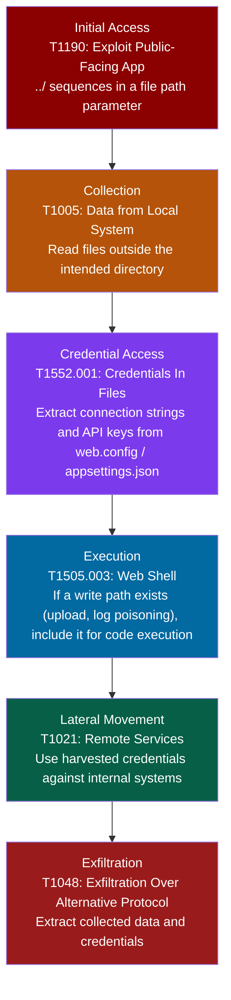

# Path Traversal / Local File Inclusion → ATT&CK Chain

## What the Scanner Flags

- **CWE-22**: Improper Limitation of a Pathname to a Restricted Directory (Path Traversal)
- **OWASP**: A01:2021 Broken Access Control
- **Common findings**: `Path.Combine(basePath, userInput)` with no validation that the resolved path stays under `basePath`, `File.ReadAllBytes()`/`File.ReadAllText()` called directly on a request-derived path, static file middleware serving outside its configured root

## ATT&CK Techniques Enabled

| Tactic | Technique ID | Technique Name | How |
|--------|-------------|----------------|-----|
| Initial Access | [T1190](https://attack.mitre.org/techniques/T1190/) | Exploit Public-Facing Application | `../../../` sequences (or their encoded variants) in a file name, download, or template parameter escape the intended directory |
| Collection | [T1005](https://attack.mitre.org/techniques/T1005/) | Data from Local System | Reads files the application never intended to expose: other users' uploads, application source, server configuration |
| Credential Access | [T1552.001](https://attack.mitre.org/techniques/T1552/001/) | Unsecured Credentials: Credentials In Files | `web.config` and `appsettings.json` routinely hold database connection strings and API keys in plaintext, prime targets once arbitrary file read is possible |
| Execution | [T1505.003](https://attack.mitre.org/techniques/T1505/003/) | Server Software Component: Web Shell | If the application also has any write path (file upload, log file), the attacker writes a payload there and uses the traversal read to include and execute it (classic LFI-to-RCE via log poisoning) |
| Lateral Movement | [T1021](https://attack.mitre.org/techniques/T1021/) | Remote Services | Credentials harvested from config files are reused against the database or internal services they authenticate to |
| Exfiltration | [T1048](https://attack.mitre.org/techniques/T1048/) | Exfiltration Over Alternative Protocol | Collected files and credentials extracted over DNS or HTTP callback |

## Read vs. Write vs. LFI-to-RCE

**Path traversal (read)** is the base case: the attacker reads a file outside the intended directory. Impact is information disclosure, bounded by what's readable on disk.

**Path traversal (write)** is more severe: if the same unsanitized-path pattern exists on an upload or export endpoint, the attacker writes a file outside the intended directory instead of reading one, for example overwriting a configuration file or planting a script in a web-accessible folder.

**LFI-to-RCE** chains the two: use any available write primitive (a file upload, a log line the attacker controls, a session file) to plant code, then use the traversal read/include to execute it. This is why a path traversal finding that looks like "just" an information disclosure bug is worth checking against every other input the application accepts, not dismissing on its own.

## .NET Specific Attack Surface

**`Path.Combine` does not sanitize.** `Path.Combine(uploadsDir, userFileName)` with `userFileName = "../../../../web.config"` produces exactly that resolved path, `Path.Combine` only joins segments, it has no concept of "stay inside this directory." The fix is to resolve the full path and verify it starts with the intended base directory (`Path.GetFullPath` plus a prefix check), not to swap in a different combine method.

**Configuration files are a self-inflicted target.** ASP.NET's own convention puts connection strings and secrets in `web.config` or `appsettings.json` at the application root, exactly the kind of file a traversal payload is written to reach. `dotnet user-secrets` or a vault (Azure Key Vault, AWS Secrets Manager) removes the secret from disk entirely, which also removes it as a traversal target.

**Static file middleware misconfiguration.** `app.UseStaticFiles()` with a `PhysicalFileProvider` pointed above `wwwroot`, or a custom file-serving endpoint that concatenates a request parameter onto a root path, reintroduces the exact bug IIS and ASP.NET's defaults were designed to prevent.

**Double encoding bypasses naive filters.** A filter that blocks literal `../` but checks before URL-decoding will miss `%2e%2e%2f` or double-encoded `%252e%252e%252f`. Validate the fully decoded, fully resolved path, not the raw input string.

## Detection Strategies by Stage

### At Initial Access (T1190)
- WAF rules for `../` and its encoded variants (`%2e%2e`, `%252e`, backslash variants on Windows paths) in file parameters
- Log file-access requests where the resolved path falls outside the expected base directory, this is the single clearest signal and most apps don't log it today

### At Collection (T1005)
- File integrity monitoring / access auditing on sensitive files (`web.config`, `appsettings.json`, `/etc/passwd` equivalents) to catch reads from the application process outside normal startup
- Alert on the application process reading files with unusual extensions or paths relative to its working directory

### At Credential Access (T1552.001)
- Secrets scanning on any file the application serves or logs, so a credential exposure is caught even if the traversal itself wasn't
- Rotate any credential found in a plaintext config file as a standing practice, not just after an incident

### At Execution (T1505.003)
- File integrity monitoring on web-accessible directories for newly created `.aspx`, `.ashx`, or `.asmx` files
- Alert on the application process spawning child processes or loading assemblies it didn't load at startup

## Response Playbook

### Contain
1. Block the source IP and the specific traversal pattern at the WAF
2. Rotate any credentials found in files the attacker could have read (connection strings, API keys, signing keys)
3. If a web shell was planted, isolate the server and remove the file before restoring from a known-good deployment

### Investigate
1. Review access logs for the full set of paths requested with traversal sequences to determine what was actually read
2. Check whether any write-capable endpoint (upload, log, export) was used in combination with the read
3. Confirm whether configuration files were among the files accessed, and treat any credentials in them as compromised

### Remediate
1. Resolve the full path and verify it starts with the intended base directory before any file operation; reject anything that doesn't
2. Move secrets out of `web.config`/`appsettings.json` into a vault or `dotnet user-secrets`, removing them as a traversal target entirely
3. Serve user-uploaded content from a dedicated storage layer (blob storage, a CDN) rather than the application's own filesystem where possible

### Prevent Recurrence
1. SAST rule for `Path.Combine`, `File.ReadAllBytes`, `File.ReadAllText`, and `StreamReader` calls taking a request-derived argument with no accompanying path-resolution check (this repo's `dotnet-path-traversal-combine` rule, see [dotnet-security-rules](https://github.com/adamtamenne/dotnet-security-rules))
2. Code review checklist item: any file operation taking user input must show the base-directory check in the same diff
3. Integration test asserting that a traversal payload against every file-accepting endpoint returns a 400, not file contents

## Cross-References

- [Insecure Deserialization Mapping](insecure-deserialization.md) for another execution-path chain via untrusted input
- [dotnet-security-rules: dotnet-path-traversal-combine](https://github.com/adamtamenne/dotnet-security-rules/blob/main/rules/path-traversal-combine.yml), the Semgrep rule that catches this pattern at the code level
- CWE-22: https://cwe.mitre.org/data/definitions/22.html
