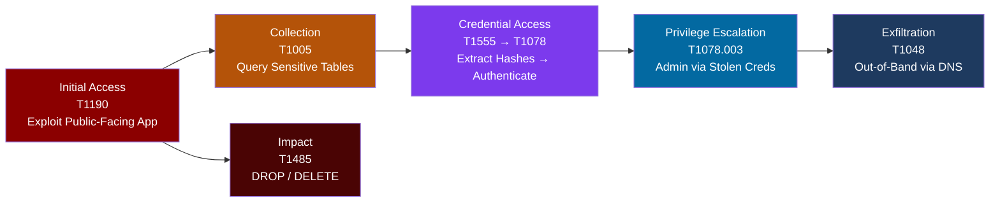

# SQL Injection → ATT&CK Chain

## What the Scanner Flags

- **CWE-89**: Improper Neutralization of Special Elements used in an SQL Command
- **OWASP**: A03:2021 Injection
- **Common finding**: User input concatenated directly into SQL queries without parameterization

## ATT&CK Techniques Enabled

| Tactic | Technique ID | Technique Name | How |
|--------|-------------|----------------|-----|
| Initial Access | [T1190](https://attack.mitre.org/techniques/T1190/) | Exploit Public-Facing Application | Malicious SQL through input fields, query parameters, or API endpoints |
| Collection | [T1005](https://attack.mitre.org/techniques/T1005/) | Data from Local System | `SELECT *` on sensitive tables; UNION-based extraction of schema, users, secrets |
| Credential Access | [T1555](https://attack.mitre.org/techniques/T1555/) | Credentials from Password Stores | Extract password hashes, API keys, or tokens stored in the database |
| Credential Access | [T1078](https://attack.mitre.org/techniques/T1078/) | Valid Accounts | Recovered credentials used to authenticate as legitimate users |
| Privilege Escalation | [T1078.003](https://attack.mitre.org/techniques/T1078/003/) | Valid Accounts: Local Accounts | Admin credentials from the database used to escalate within the application |
| Exfiltration | [T1048](https://attack.mitre.org/techniques/T1048/) | Exfiltration Over Alternative Protocol | Out-of-band extraction via DNS (e.g., `LOAD_FILE()` to attacker-controlled server) |
| Impact | [T1485](https://attack.mitre.org/techniques/T1485/) | Data Destruction | `DROP TABLE`, `DELETE FROM` against production data |

## Detection Strategy

### At Initial Access (T1190)
- WAF rules for common SQL metacharacters (`'`, `--`, `UNION`, `SELECT`, `1=1`) in request parameters
- Application logs showing SQL errors returned to users (500s with database error strings)
- SIEM correlation: repeated 500 errors from a single source IP on endpoints that accept user input

### At Collection (T1005)
- Database audit logs showing unusual `SELECT` volume or queries against tables the application doesn't normally read
- Slow query logs showing `UNION`-based queries or `INFORMATION_SCHEMA` enumeration
- Data access patterns outside the application's normal behavior (time of day, tables accessed, row counts)

### At Credential Access (T1555, T1078)
- Queries against user/credential tables that don't come from the application's connection pool
- Successful logins from IPs that previously triggered WAF SQL injection alerts
- Credential stuffing patterns following a suspected extraction

### At Exfiltration (T1048)
- DNS logs showing unusually long subdomains or high query volume to unfamiliar domains
- Outbound connections from the database server to external IPs
- Network monitoring for data leaving through non-standard channels

## Response Playbook

### Contain
1. Block the source IP at the WAF/load balancer
2. Rotate database credentials immediately
3. If data exfiltration is suspected, isolate the affected database and capture forensic state

### Investigate
1. Pull WAF and application logs for the source IP across all endpoints
2. Query database audit logs for the session to determine what data was accessed
3. Check for successful authentication using any credentials stored in the database
4. Review DNS logs for out-of-band exfiltration indicators

### Remediate
1. Fix the vulnerable query with parameterized statements
2. Deploy WAF rule for the specific injection pattern as an interim measure
3. Audit the codebase for the same query pattern in other endpoints
4. If credentials were exposed, force password resets for affected users

### Prevent Recurrence
1. SAST rule to catch string concatenation in SQL queries (Semgrep: `rules/sql-injection`)
2. DAST scan with authenticated crawl covering the affected endpoint
3. Add parameterized query enforcement to the code review checklist
4. Database accounts should follow least privilege (application user cannot read credential tables unless required)

## Cross-References

- [OWASP Top 10 Exploitation: SQL Injection](https://github.com/adamtamenne/owasp-top10-exploitation)
- [Threat Model: Data Flow Diagrams](https://github.com/adamtamenne/threat-modeling)
- [DevSecOps Pipeline: Semgrep Rules](https://github.com/adamtamenne/devsecops-pipeline-demo/tree/main/security/semgrep-rules)