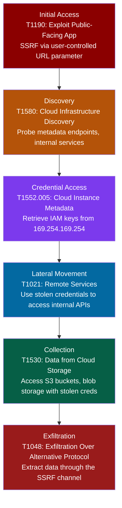

# Server-Side Request Forgery (SSRF)

## Attack Lifecycle

## ATT&CK Techniques

| Stage | Technique ID | Technique Name | How It Applies |
|-------|-------------|----------------|----------------|
| Initial Access | T1190 | Exploit Public-Facing Application | Attacker submits a crafted URL to an application endpoint that makes server-side HTTP requests |
| Discovery | T1580 | Cloud Infrastructure Discovery | SSRF probes internal network ranges, cloud metadata endpoints, and internal service APIs |
| Credential Access | T1552.005 | Cloud Instance Metadata API | Fetches temporary IAM credentials from the cloud provider metadata service (169.254.169.254 on AWS, metadata.google.internal on GCP) |
| Lateral Movement | T1021 | Remote Services | Uses stolen IAM credentials to authenticate to internal services the application server has access to |
| Collection | T1530 | Data from Cloud Storage | Accesses cloud storage (S3, GCS, Azure Blob) using the stolen role credentials |
| Exfiltration | T1048 | Exfiltration Over Alternative Protocol | Extracts data through the SSRF vector itself or through DNS/HTTP callbacks |

## Detection Strategies by Stage

### Initial Access: SSRF Request

- Monitor outbound HTTP requests from application servers for requests to internal IP ranges (10.x, 172.16.x, 192.168.x, 169.254.x)
- Alert on application-initiated requests to cloud metadata endpoints
- WAF rules to detect and block metadata IP addresses in user-supplied URL parameters
- Log all outbound requests from application servers with the originating user input

### Discovery: Internal Probing

- Network segmentation monitoring for unexpected traffic from web tier to internal services
- DNS query logging for internal hostnames resolved by application servers
- Detect port scanning patterns from application server IPs

### Credential Access: Metadata Theft

- IMDSv2 enforcement (require PUT-based token exchange, block direct GET to metadata)
- Alert on any access to the metadata endpoint from application containers/instances
- Monitor CloudTrail/audit logs for credential use from unexpected source IPs

### Lateral Movement: Credential Abuse

- Flag IAM credential usage from IPs outside the expected instance/container range
- Monitor for unusual API calls from application service roles
- Alert when credentials are used to access services not in the application's normal call pattern

## Response Playbook

1. **Confirm the SSRF vector.** Identify the vulnerable endpoint and parameter. Determine if the SSRF is blind (no response body) or full (response returned to attacker).
2. **Check metadata access.** Review cloud provider logs for metadata endpoint access from the affected instance. If IMDSv2 is not enforced, assume credential theft.
3. **Rotate affected credentials.** Immediately rotate any IAM role credentials associated with the affected instance. Revoke active sessions.
4. **Audit credential usage.** Review CloudTrail/audit logs for any API calls made with the stolen credentials between the time of compromise and rotation.
5. **Patch the SSRF.** Implement a URL allowlist for outbound requests. Block requests to private IP ranges and metadata endpoints at the application level. Enable IMDSv2 if on AWS.
6. **Network segmentation.** Restrict the application server's ability to reach internal services it does not need. Apply least-privilege network policies.

## Cross-References

- Related to [SQL Injection](sql-injection.md) when SSRF is used to reach an internal database endpoint
- SSRF to cloud metadata is the most common cloud-native privilege escalation path
- OWASP Top 10 2021: A10 Server-Side Request Forgery
