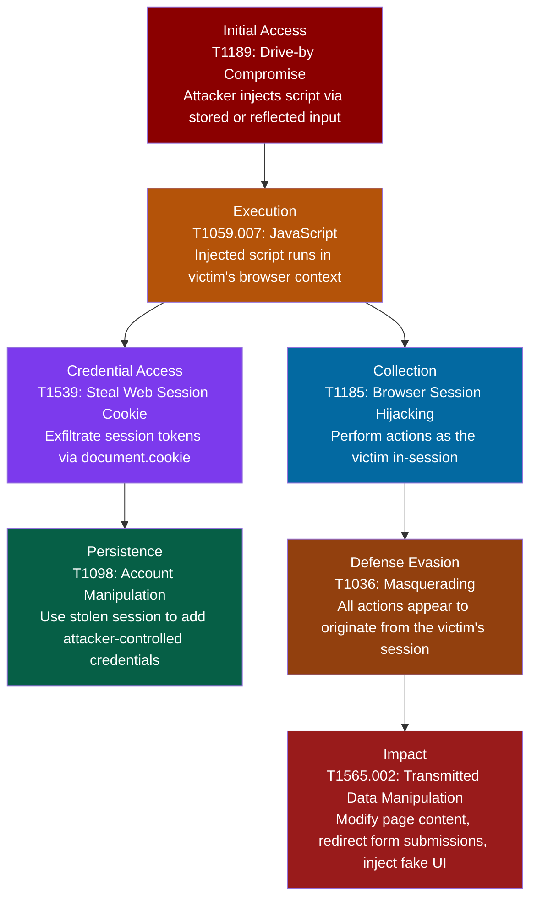

# Cross-Site Scripting (XSS) → ATT&CK Chain

## What the Scanner Flags

- **CWE-79**: Improper Neutralization of Input During Web Page Generation
- **OWASP**: A03:2021 Injection
- **Common findings**: `Html.Raw()` in Razor views, `innerHTML` assignment, `document.write()`, unencoded output in template literals, `dangerouslySetInnerHTML` in React

## ATT&CK Techniques Enabled

| Tactic | Technique ID | Technique Name | How |
|--------|-------------|----------------|-----|
| Initial Access | [T1189](https://attack.mitre.org/techniques/T1189/) | Drive-by Compromise | Attacker stores malicious script in a database field (comment, profile, message) or crafts a URL with a reflected payload |
| Execution | [T1059.007](https://attack.mitre.org/techniques/T1059/007/) | Command and Scripting Interpreter: JavaScript | Browser executes the injected script in the origin's security context with full DOM access |
| Credential Access | [T1539](https://attack.mitre.org/techniques/T1539/) | Steal Web Session Cookie | Script reads `document.cookie` and exfiltrates session tokens to attacker infrastructure via fetch or image beacon |
| Collection | [T1185](https://attack.mitre.org/techniques/T1185/) | Browser Session Hijacking | Script makes authenticated API calls using the victim's active session without needing the cookie itself |
| Persistence | [T1098](https://attack.mitre.org/techniques/T1098/) | Account Manipulation | Stolen session used to add a new email address, change password, or register an API key on the victim's account |
| Defense Evasion | [T1036](https://attack.mitre.org/techniques/T1036/) | Masquerading | All requests originate from the victim's browser with their IP, user-agent, and session; indistinguishable from legitimate activity in access logs |
| Impact | [T1565.002](https://attack.mitre.org/techniques/T1565/002/) | Data Manipulation: Transmitted Data Manipulation | Script modifies the visible page: injects fake login forms, rewrites links to phishing domains, alters displayed account balances or transaction history |

## XSS Variant Breakdown

### Stored (Persistent) XSS
Payload is saved server-side (database, file, cache) and rendered to every user who views the affected page. Highest impact because it requires no victim interaction beyond visiting a normal page. Common in comment fields, user profiles, forum posts, and admin dashboards displaying user-submitted data.

### Reflected XSS
Payload is embedded in a URL parameter or form input and reflected back in the immediate response without storage. Requires the attacker to deliver the crafted URL to the victim via phishing, social engineering, or a redirect from a trusted domain.

### DOM-based XSS
Payload never reaches the server. Client-side JavaScript reads from an attacker-controllable source (`location.hash`, `document.referrer`, `postMessage`) and writes to a dangerous sink (`innerHTML`, `eval`, `document.write`). Invisible to server-side WAFs and logging.

## .NET Specific Attack Surface

**Razor Views**: ASP.NET Razor auto-encodes `@Model.Property` output by default, but `@Html.Raw()` bypasses this entirely. A single `Html.Raw()` on user-controlled input is a stored XSS vector.

**Web API + SPA**: ASP.NET Web API returns JSON that a frontend framework renders. If the SPA uses `dangerouslySetInnerHTML` (React) or `v-html` (Vue) or `[innerHTML]` (Angular) on API response data, XSS moves from server templates to client rendering.

**Legacy Web Forms**: `Response.Write()` and `<%= %>` expressions in .aspx pages have no auto-encoding. `HttpUtility.HtmlEncode()` must be called explicitly on every output.

**Anti-XSS Library**: .NET provides `System.Web.Security.AntiXss.AntiXssEncoder` and the newer `System.Text.Encodings.Web.HtmlEncoder` for context-aware encoding (HTML body, attribute, JavaScript, URL).

## Detection Strategies by Stage

### At Initial Access (T1189)
- Input validation and WAF rules for common XSS payloads (`<script>`, `onerror=`, `javascript:`, event handlers)
- Content Security Policy (CSP) headers to restrict script sources and block inline execution
- Monitor for HTML tags in fields that should be plaintext (names, addresses, comments)

### At Execution (T1059.007)
- CSP `report-uri` or `report-to` directives to capture blocked inline script execution attempts
- Subresource Integrity (SRI) to detect tampered scripts
- Browser-side monitoring for unexpected `eval()`, `document.write()`, or dynamic script injection

### At Credential Access (T1539)
- Set `HttpOnly` flag on session cookies to prevent `document.cookie` access from JavaScript
- Set `SameSite=Strict` or `SameSite=Lax` to limit cross-origin cookie transmission
- Monitor for session tokens used from new IP addresses or user-agents

### At Persistence (T1098)
- Require re-authentication for sensitive account changes (email, password, MFA)
- Alert on account modifications that follow a session origin change
- Audit log for credential and permission changes with session metadata

## Response Playbook

### Contain
1. Identify the injection point and remove or encode the stored payload
2. Invalidate all active sessions for affected users
3. Deploy a CSP header blocking inline scripts if not already in place
4. If reflected, block the malicious URL pattern at the WAF

### Investigate
1. Determine the XSS variant (stored, reflected, DOM) and the injection vector
2. Review access logs for the payload delivery mechanism
3. Check for session token exfiltration by correlating session reuse from different IPs
4. Audit account changes made during the window of exposure
5. Search for the same unencoded output pattern in other views and endpoints

### Remediate
1. Apply output encoding at the template layer (let Razor auto-encode; remove `Html.Raw()` on user input)
2. Implement Content Security Policy with `script-src` restricting to known sources
3. Set `HttpOnly`, `Secure`, and `SameSite` attributes on all session cookies
4. Add input validation as defense in depth (not a replacement for output encoding)

### Prevent Recurrence
1. SAST rule to flag `Html.Raw()`, `innerHTML`, `document.write()`, and `dangerouslySetInnerHTML` on user-controlled data
2. Code review checklist: any raw HTML rendering must justify why auto-encoding is insufficient
3. Automated CSP header validation in CI pipeline
4. Security regression test: submit XSS payloads to all input fields and verify they render as text

## Cross-References

- [Semgrep Rules: XSS Html.Raw](https://github.com/adamtamenne/dotnet-security-rules/blob/main/rules/xss-html-raw.yml)
- [SQL Injection Mapping](sql-injection.md) for post-authentication data access chains
- [Insecure Deserialization Mapping](insecure-deserialization.md) for execution-to-persistence overlap
- OWASP XSS Prevention Cheat Sheet: https://cheatsheetseries.owasp.org/cheatsheets/Cross-Site_Scripting_Prevention_Cheat_Sheet.html
